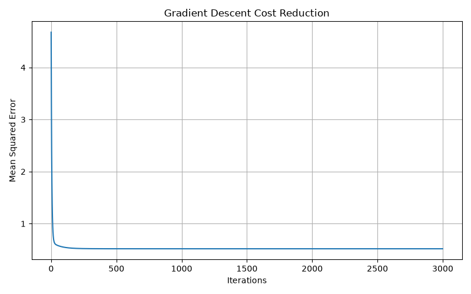

# ML-1: Linear Regression from Scratch

## Project Overview

This project implements Linear Regression from scratch using NumPy. It demonstrates how gradient descent learns model parameters by minimizing Mean Squared Error (MSE).

The California Housing dataset is used to train and evaluate the model.

## Technologies Used

* Python
* NumPy
* Pandas
* Matplotlib
* Scikit-learn

## Dataset

**California Housing Dataset**

* Total records: 20,640
* Input features: 8
* Target variable: MedHouseVal
* Training records: 16,512
* Testing records: 4,128

## Implementation

1. Dataset loading and preprocessing.
2. Training and testing data splitting.
3. Feature standardization.
4. Linear Regression implementation using NumPy.
5. Hypothesis function: `h(X) = Xθ`
6. Mean Squared Error cost function.
7. Gradient Descent optimization.
8. Single-feature and multiple-feature regression.
9. Manual calculation of MSE and R².
10. Comparison with Scikit-learn Linear Regression.

## Results

| Metric   | NumPy Implementation | Scikit-learn |
| -------- | -------------------: | -----------: |
| Test MSE |            0.5558916 |    0.5558916 |
| R² Score |            0.5757877 |    0.5757877 |

The model achieved an R² score of approximately **57.58%**.

## Gradient Descent Visualization

The cost reduction graph shows that the Mean Squared Error decreases during training and converges towards approximately 0.52.



## How to Run

Clone the repository:

```bash
git clone https://github.com/nithinkumar2102/ML-1-Linear-Regression.git
```

Navigate into the project:

```bash
cd ML-1-Linear-Regression
```

Install dependencies:

```bash
python -m pip install -r requirements.txt
```

Run the project:

```bash
python src/linear_regression.py
```

## Project Structure

```text
ML-1-Linear-Regression/
│
├── dataset/
├── outputs/
│   └── cost_convergence.png
├── src/
│   └── linear_regression.py
├── README.md
├── requirements.txt
└── .gitignore
```

## Conclusion

This project demonstrates the mathematical working of Linear Regression and Gradient Descent without using Scikit-learn for model training. The NumPy implementation produces results nearly identical to Scikit-learn's Linear Regression model.
